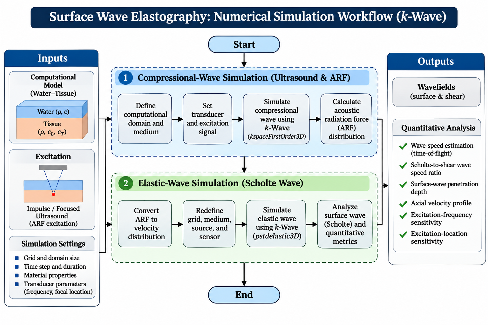

# Numerical Simulation of Scholte-Wave Elastography Using k-Wave

MATLAB/k-Wave research code for simulating impulse-induced **Scholte surface waves** at a water-tissue interface. The workflow couples an ultrasound compressional-wave simulation to acoustic-radiation-force (ARF) estimation and a subsequent elastic-wave simulation, then quantifies Scholte and shear-wave propagation.



## Overview

This repository contains the MATLAB implementation used to investigate surface-wave elastography at a liquid-tissue interface. The model represents water over soft tissue, generates a focused ultrasound field, estimates ARF, converts the force field to an elastic-wave source, and simulates the resulting Scholte and shear waves.

The code also includes analysis routines for wave-speed estimation, Scholte-to-shear speed ratio, axial velocity profiles, penetration depth, and excitation-parameter comparisons.

## Simulation workflow

1. Define the computational grid, PML, water/tissue properties, and simulation time.
2. Define the ultrasound transducer and tone-burst excitation.
3. Run the 3D compressional-wave model with `kspaceFirstOrder3D`.
4. Calculate ARF using quasi-plane-wave, attenuated-plane-wave, and second-order formulations.
5. Re-grid the ARF field for the elastic model and convert force to an initial velocity distribution.
6. Run the 2D elastic-wave simulation with `pstdElastic2D`.
7. Analyze Scholte and shear-wave propagation using time-of-flight peak tracking.
8. Evaluate penetration depth and excitation-dependent wave behavior.

## Model configuration in the supplied script

| Parameter | Value |
|---|---:|
| Water compressional speed | 1480 m/s |
| Water density | 1000 kg/m^3 |
| Tissue compressional speed | 1540 m/s |
| Tissue shear-wave speed | 10 m/s |
| Tissue density | 1050 kg/m^3 |
| Compressional grid spacing | 0.03 mm |
| Excitation frequency | 5 MHz |
| Transducer elements | 17 |
| Focus distance | 7.5 mm |
| Elastic grid spacing | 0.2 mm |

## Repository structure

```text
scholte-wave-elastography/
├── README.md
├── LICENSE
├── CITATION.cff
├── .gitignore
├── src/
│   └── Scholte_wave_sim_Final.m
├── figures/
│   └── surface_wave_workflow.png
├── data/
│   └── README.md
└── results/
    └── README.md
```

## Requirements

- MATLAB
- [k-Wave MATLAB toolbox](https://www.k-wave.org/)
- MATLAB Signal Processing Toolbox (`findpeaks`)
- `tight_subplot` is used by one plotting section and must be available on the MATLAB path if that section is run.

The script calls k-Wave routines including `kWaveGrid`, `kWaveTransducer`, `toneBurst`, `kspaceFirstOrder3D`, and `pstdElastic2D`.

## Running the code

1. Install k-Wave and add it to the MATLAB path.
2. Clone/download this repository.
3. Open `src/Scholte_wave_sim_Final.m`.
4. Review the parameters near the beginning of the script.
5. Replace or remove the machine-specific `.mat` file paths described below.
6. Run the script section-by-section in MATLAB.

> **Computational note:** the 3D acoustic model can be memory- and compute-intensive. Start with reduced grid/time settings when validating a new installation.

## Important portability note

The research script is preserved close to the working analysis version and contains several absolute Windows paths such as:

```matlab
C:\Users\BARL\Downloads\k-wave-toolbox-version-1.2.1\k-Wave\Scholte_final\...
```

These refer to intermediate velocity/pressure `.mat` files used during development. They are **not included in this repository**. To reproduce those branches of the analysis, either regenerate the intermediate arrays from the acoustic simulation or replace the paths with local files stored under `data/`.

Large generated arrays, `.mat` outputs, and AVI files are intentionally excluded from version control by `.gitignore`.

## Main outputs

The script can generate:

- normalized acoustic pressure fields;
- ARF component maps for multiple approximation methods;
- ARF vector-field visualizations;
- elastic-wave velocity fields;
- AVI visualization of simulated elastic-wave propagation;
- Scholte-wave and shear-wave time-of-flight profiles;
- Scholte and shear-wave velocity estimates and their ratio;
- penetration-depth profiles;
- comparisons of excitation frequency and focal location.

## Research context

This code accompanies the PhD dissertation:

> **Al Masud, A. (2024). _Numerical Simulation of Impulse-Induced Surface Acoustic Wave Elastography Using k-Wave Acoustic Simulation Toolbox_. Texas Tech University.**

> **Masud, A. A.**, & Liu, J. (2024). Numerical simulation of impulse-induced surface acoustic waves for elastography purposes using k-Wave simulation toolbox. Journal of Applied Physics, 136(16).
The broader dissertation develops numerical frameworks for surface acoustic-wave elastography and investigates how acoustic excitation parameters affect wave generation, propagation, and tissue interrogation.

## Citation

If you use or adapt this repository, please cite the dissertation. Citation metadata is also provided in `CITATION.cff`.

## License

This repository is provided under the MIT License. See `LICENSE`.
